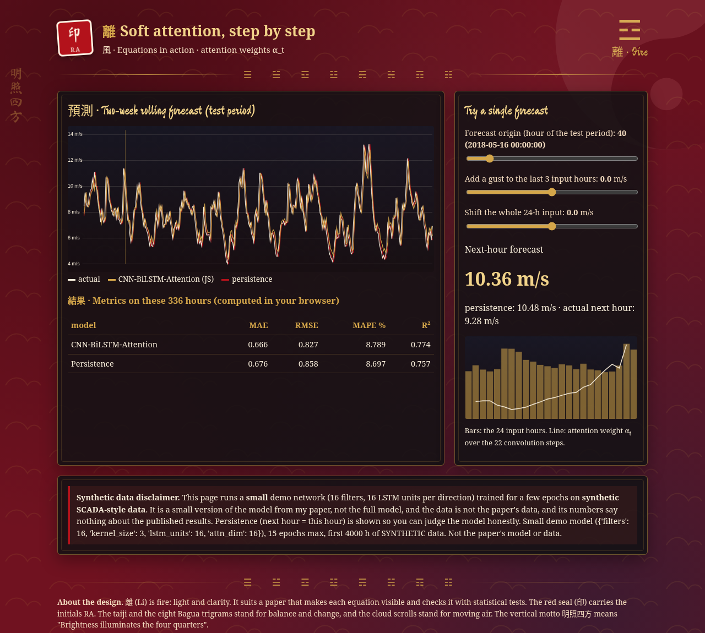

<p align="center"></p>

# Mathematical Formulations and Statistical Validation of Hybrid Deep Learning Models for Wind Speed Forecasting (Reference Implementation)

[](https://rishabh-bgp.github.io/wind-forecasting-mathematical-formulations-validation/) [](https://github.com/Rishabh-bgp/wind-forecasting-mathematical-formulations-validation/actions/workflows/ci.yml) [](https://colab.research.google.com/github/Rishabh-bgp/wind-forecasting-mathematical-formulations-validation/blob/main/notebooks/walkthrough.ipynb) [](LICENSE)  

> **Reference implementation.** This is the reference implementation of my paper (R. Aryan and Manimozhi I), rebuilt in Python on synthetic data because the original data is confidential. Results will differ from the published numbers.

**Keywords:** attention mechanism, bilstm, cnn bilstm, deep learning, diebold mariano, lstm, machine learning, pytorch, renewable energy, scada, time series forecasting, wind energy, wind speed forecasting

## Paper · 論文

R. Aryan and Manimozhi I, "Mathematical formulations, optimization, and statistical validation of hybrid deep learning models for short-term wind speed forecasting: A comparative analysis of ANN, LSTM, SVM, ARIMA-ANN, CNN-BiLSTM, and CNN-BiLSTM-Attention architectures," *Int. J. Res. Adv. Comput. Sci. Eng. (IJRACSE)*, vol. 12, no. 1, pp. 46–53, May 2026. [Online]. Available: https://gnpublication.org/index.php/cse

**Hybrid deep learning: equations to code** is the reference implementation of my paper on the mathematical formulations and statistical validation of hybrid deep learning models for wind speed forecasting. The paper proposes a unified **mathematical formulation** of six wind speed forecasting models (ANN, LSTM, SVM/SVR, ARIMA–ANN, CNN–BiLSTM and CNN–BiLSTM–Attention). It covers layer equations, LSTM gates, soft attention, MSE loss, backpropagation through time, Adam updates, and optimizer and learning-rate studies. It also sets out a full **statistical validation** toolkit: Ljung–Box, Shapiro–Wilk, Breusch–Pagan and Diebold–Mariano.

## Method · 方法

Code that maps one-to-one onto the paper's equations:
- **ANN** (Sec. 3.1, x in R^24 -> affine + ReLU layers), **LSTM/BiLSTM** gates (3.2-3.3, `torch.nn.LSTM`), **1-D convolution** ((T-k+1) x F output, 3.4), **soft attention** e_t = v^T tanh(W_a h_t + b_a), alpha = softmax(e), c = sum alpha_t h_t (3.5, `models.SoftAttention`), **SVR** with RBF kernel (3.6), **ARIMA-ANN** y = L + N (3.7, `models.arima_ann`), **CNN-BiLSTM-Attention** (3.8).
- **MSE loss + Adam** (Sec. 4), training/validation **loss curves** for all deep models (`details.json -> loss_history`).
- **Learning-rate sensitivity** of the hybrid (1e-4, 5e-4, 1e-3, 5e-3, 1e-2) and **optimizer comparison** (Adam vs RMSprop vs SGD+Momentum), Sec. 4.4-4.5.
- **Statistical validation** (Sec. 5): MAE/RMSE/MAPE/R2, Shapiro-Wilk normality, **Ljung-Box p-values at lags 1-24** for the hybrid and LSTM, Breusch-Pagan heteroskedasticity, **Diebold-Mariano** (with Harvey-Leybourne-Newbold correction, `stats.diebold_mariano`).

## Architecture · 架構

```
input  : last 24 hourly wind speeds (min-max scaled, scaler fit on train only)
Conv1D : 64 filters, kernel 3, ReLU            -> (22 x 64)
BiLSTM : 64 units per direction, full sequence -> (22 x 128)
Soft attention: e_t = v^T tanh(W_a h_t + b_a), alpha = softmax(e), c = sum alpha_t h_t
Dense  : 1 unit = predicted CHANGE from the last reading
output : forecast = last reading + predicted change
```
Training: Adam (lr 0.001), MSE loss, batch 32, up to 100 epochs, early stopping (patience 10), fixed seed 42.
Data split: chronological 80 % train / 20 % test; 24 -> 1 sliding window.
Target: every learned model (deep and shallow) predicts the **change from the last reading** (`target: delta` in the config; set `target: level` to predict the value directly). Persistence is the special case where the predicted change is zero.

## Data · 數據

**The original SCADA dataset used in the paper is not publicly available** (it is confidential and
is not, and will never be, included in this repository).

- `data/synthetic/synthetic_scada.csv` is a **SYNTHETIC** hourly SCADA-style wind speed series generated by
  `scripts/make_synthetic_data.py` (seed 42). It is committed only so the code runs out of the box.
  It is not measured data, and results on it say nothing about the published results.
- To use your own data locally, put a CSV anywhere under `data/` (for example `data/scada.csv`)
  with columns `timestamp,wind_speed` (other names: set `timestamp_col` / `wind_col`; 10-minute data is mean-resampled to hourly), and point `data.csv` in `configs/default.yaml` at it. Everything in `data/` except the
  committed synthetic CSV is git-ignored, so your file will not be committed.

## How to run · 執行

```bash
python -m venv .venv && source .venv/bin/activate   # Windows: .venv\Scripts\activate
pip install -r requirements.txt
python train.py --quick      # smoke test: 3 epochs, short series, small grids
python train.py              # full run with the paper's settings
python -m pytest -q          # tests (incl. JS-vs-Python demo check; needs Node.js)
```

Outputs in `results/`: `metrics.csv` (MAE, RMSE, MAPE, R2 per model), `predictions.csv`,
`details.json` (Diebold-Mariano tests vs the hybrid, Ljung-Box / Shapiro-Wilk / Breusch-Pagan
residual diagnostics, wind-regime stratified RMSE, RMSE reduction %, loss curves).

## Results (synthetic data only) · 結果

These are the real numbers from runs on the **synthetic** CSV. They are not the paper's results, and they are not tuned to match them. Every learned model predicts the **change from the last reading**, so persistence (change = 0) is the honest baseline to beat.

**1. Smoke test** (`python train.py --quick`: first 2,000 hours, 3 epochs, small hyper-parameter grids; test = last 400 hours):

| Rank | Model | MAE (m/s) | RMSE (m/s) | MAPE (%) | R² |
|---:|---|---:|---:|---:|---:|
| 1 | LSTM | 0.595 | 0.751 | 7.99 | 0.733 |
| 2 | ARIMA-ANN | 0.604 | 0.752 | 8.19 | 0.733 |
| 3 | ANN | 0.601 | 0.753 | 8.07 | 0.732 |
| 4 | CNN-BiLSTM | 0.601 | 0.754 | 8.09 | 0.731 |
| 5 | CNN-BiLSTM-Attention | 0.602 | 0.762 | 7.97 | 0.725 |
| 6 | **Persistence** | 0.597 | 0.764 | 7.87 | 0.723 |
| 7 | SVM (SVR-RBF) | 0.768 | 0.970 | 10.31 | 0.555 |

Does CNN–BiLSTM–Attention beat persistence? RMSE 0.762 vs 0.764 m/s (beats persistence), MAE 0.602 vs 0.597 m/s (does not beat persistence). Models with lower RMSE than persistence in this run: LSTM, ARIMA-ANN, ANN, CNN-BiLSTM, CNN-BiLSTM-Attention. The margins are small, and three epochs are a smoke test, not a tuned result.

**2. Small demo model** (the one on the live demo: 16 filters, 16 LSTM units per direction, up to 15 epochs, first 4,000 hours; test = last 800 hours):

| Model | MAE (m/s) | RMSE (m/s) | MAPE (%) | R² |
|---|---:|---:|---:|---:|
| CNN–BiLSTM–Attention (small) | 0.614 | 0.771 | 8.49 | 0.750 |
| **Persistence** | 0.617 | 0.795 | 8.35 | 0.734 |

Does it beat persistence? RMSE 0.771 vs 0.795 m/s (beats persistence), MAE 0.614 vs 0.617 m/s (beats persistence). On this smooth synthetic series, persistence is a strong baseline, so any gain is modest.

## Live demo · 演示

<a href="https://rishabh-bgp.github.io/wind-forecasting-mathematical-formulations-validation/"></a>

**Live demo:** https://rishabh-bgp.github.io/wind-forecasting-mathematical-formulations-validation/ (runs entirely in your browser on synthetic data)

**About the demo design.** The page uses a Daoist, Chinese-ink style: crimson, charcoal and navy with gold accents, brush-style headings in the Ma Shan Zheng font, and charts drawn in gold, red and ink. Each repository has its own trigram. This one is **離 ☲ (Lí, Fire)**. 離 (Lí) is fire: light and clarity. It suits a paper that makes each equation visible and checks it with statistical tests. The red seal stamp (印) carries the initials RA, the faint taiji and the row of eight Bagua trigrams stand for balance and change, and the vertical motto 明照四方 means "Brightness illuminates the four quarters". The design is purely decorative. Everything is computed by the model shown, on synthetic data.

## Notebook · 筆記本

[`notebooks/walkthrough.ipynb`](notebooks/walkthrough.ipynb) is a beginner-friendly, self-contained version of the code, with explanations in plain words. It runs in Colab or in Anaconda Jupyter on Windows, macOS or Linux:

1. Load the synthetic SCADA-style CSV (local file, else download from GitHub, else generate it).
2. Fill gaps and split 80/20 by time.
3. Scale to [0, 1], fitting the scaler on training data only.
4. Turn the series into 24-hour input windows with a 1-hour target.
5. Build the CNN–BiLSTM–Attention model.
6. Train it briefly (up to 20 epochs with early stopping).
7. Compare MAE, RMSE, MAPE and R² with a persistence baseline.
8. Plot actual vs predicted.

## Tests · 測試

`python -m pytest -q` runs the tests in `tests/`:

- `test_windows_and_no_leak`: 24-hour windows are built correctly, with no leakage from the test period.
- `test_metrics_perfect`: the metrics give the exact values for a perfect forecast.
- `test_js_and_python_predictions_match`: the browser demo's JavaScript model gives the same predictions as Python (needs Node.js).

CI runs the same tests on Python 3.12 on every push.

## Repository layout · 結構

```
src/windforecast/  data.py (loader, synthetic generator, windowing, scaling)
                   models.py (CNN-BiLSTM-Attention and baselines)
                   metrics.py, stats.py (DM test, residual diagnostics)
                   experiment.py (end-to-end runner)
configs/default.yaml   train.py   tests/   notebooks/walkthrough.ipynb
scripts/make_synthetic_data.py   scripts/export_demo_model.py   demo/ (GitHub Pages source)
data/synthetic/synthetic_scada.csv (SYNTHETIC)
```

## Limitations · 局限

- All results come from synthetic data, so they say nothing about the published results or about real turbines.
- SGD+Momentum uses lr = 0.01, momentum 0.9 (the paper does not give its settings); RMSprop uses lr = 0.001.
- The learning-rate grid is an assumption (the paper only names 0.0001 and 0.001 explicitly).
- The DM test uses squared-error loss, h = 1, and the HLN small-sample correction.
- Deep models are implemented in **PyTorch**; the paper used TensorFlow/Keras.
- The early-stopping validation set is the last 10 % of the training windows (not stated in the paper).
- Attention hidden size d_a = 64 and no dropout (not stated in the paper).
- MAPE ignores hours with |y| < 0.1 m/s to avoid division by ~0 (handling not stated).
- ARIMA is evaluated as rolling one-step-ahead forecasts (parameters fit on train only), matching the 1-step horizon of the other models.

## License · 許可證

MIT © 2026 Rishabh Aryan. See [LICENSE](LICENSE). The paper itself remains under its publisher's terms.

## M.Tech Thesis Work in AI and Data Science, IIIT Bhagalpur · 學位論文

*An Investigation into Advanced Techniques for Wind Speed Forecasting with Applications to Renewable Energy Grid Integration*

This repository is part of my M.Tech thesis work.

### Quantum and hybrid quantum machine learning

| | Repository | Approach | Live |
|---|---|---|---|
| 08 ☰ 乾 Qian | [hybrid-vqc-wind-speed-forecasting](https://github.com/Rishabh-bgp/hybrid-vqc-wind-speed-forecasting) | Hybrid variational quantum circuit (Conv1D-LSTM + VQC) | [demo](https://rishabh-bgp.github.io/hybrid-vqc-wind-speed-forecasting/) |
| 10 ☵ 坎 Kan | [cbma-tn-vqc-wind-green-hydrogen](https://github.com/Rishabh-bgp/cbma-tn-vqc-wind-green-hydrogen) | CNN-BiLSTM-multi-head attention + tensor network + VQC, green hydrogen | [demo](https://rishabh-bgp.github.io/cbma-tn-vqc-wind-green-hydrogen/) |
| 12 ☶ 艮 Gen | [hcq-lstm-clqgwo-wind-forecasting](https://github.com/Rishabh-bgp/hcq-lstm-clqgwo-wind-forecasting) | Physics-informed hybrid classical-quantum LSTM tuned by a quantum-inspired grey wolf optimizer | [demo](https://rishabh-bgp.github.io/hcq-lstm-clqgwo-wind-forecasting/) |

### Metaheuristic-optimized hybrids

| | Repository | Approach | Live |
|---|---|---|---|
| 04 ☷ 坤 Kun | [geoai-hybrid-ga-pso-anfis-wind-forecasting](https://github.com/Rishabh-bgp/geoai-hybrid-ga-pso-anfis-wind-forecasting) | GA-PSO-ANFIS-CNN-LSTM, probabilistic multi-site forecasting | [demo](https://rishabh-bgp.github.io/geoai-hybrid-ga-pso-anfis-wind-forecasting/) |

### Deep learning with attention and gating

| | Repository | Approach | Live |
|---|---|---|---|
| 01 ☴ 巽 Xun | [cnn-bilstm-attention-synthetic-scada](https://github.com/Rishabh-bgp/cnn-bilstm-attention-synthetic-scada) | CNN-BiLSTM-Attention validated on synthetic SCADA-style data | [demo](https://rishabh-bgp.github.io/cnn-bilstm-attention-synthetic-scada/) |
| 02 ☳ 震 Zhen | [cnn-bilstm-attention-real-scada](https://github.com/Rishabh-bgp/cnn-bilstm-attention-real-scada) | CNN-BiLSTM-Attention on wind turbine SCADA data | [demo](https://rishabh-bgp.github.io/cnn-bilstm-attention-real-scada/) |
| 03 ☰ 乾 Qian | [cnn-bilstm-attention-benchmarking-indian-scada](https://github.com/Rishabh-bgp/cnn-bilstm-attention-benchmarking-indian-scada) | CNN-BiLSTM-Attention benchmarked against ANN, LSTM, SVM and ARIMA-ANN | [demo](https://rishabh-bgp.github.io/cnn-bilstm-attention-benchmarking-indian-scada/) |
| 05 ☲ 離 Li | [xai-shap-lime-cnn-bilstm-attention-wind](https://github.com/Rishabh-bgp/xai-shap-lime-cnn-bilstm-attention-wind) | CNN-BiLSTM-Attention explained with SHAP, LIME and attention | [demo](https://rishabh-bgp.github.io/xai-shap-lime-cnn-bilstm-attention-wind/) |
| **06 ☲ 離 Li** | **[wind-forecasting-mathematical-formulations-validation](https://github.com/Rishabh-bgp/wind-forecasting-mathematical-formulations-validation) (this repo)** | **Equations and statistical validation of six forecasting models** | **[demo](https://rishabh-bgp.github.io/wind-forecasting-mathematical-formulations-validation/)** |
| 09+13 ☵ 坎 Kan | [wuweidl-daoist-gated-wind-forecasting](https://github.com/Rishabh-bgp/wuweidl-daoist-gated-wind-forecasting) | WuWeiDL: Daoist-inspired turbulence-gated attention | [demo](https://rishabh-bgp.github.io/wuweidl-daoist-gated-wind-forecasting/) |
| 16 ☴ 巽 Xun | [rso-net-wind-grid-stabilization](https://github.com/Rishabh-bgp/rso-net-wind-grid-stabilization) | RSO-Net: TCN-attention probabilistic forecasting for grid stabilization | [demo](https://rishabh-bgp.github.io/rso-net-wind-grid-stabilization/) |

### IoT, automation and multi-agent systems

| | Repository | Approach | Live |
|---|---|---|---|
| 14 ☳ 震 Zhen | [iot-n8n-wind-turbine-predictive-maintenance](https://github.com/Rishabh-bgp/iot-n8n-wind-turbine-predictive-maintenance) | IoT predictive maintenance with forecasting, FastAPI and n8n | [demo](https://rishabh-bgp.github.io/iot-n8n-wind-turbine-predictive-maintenance/) |
| 15 ☱ 兌 Dui | [multi-agent-turbine-fleet-chief-of-staff](https://github.com/Rishabh-bgp/multi-agent-turbine-fleet-chief-of-staff) | Multi-agent chief of staff for turbine fleet operations | [demo](https://rishabh-bgp.github.io/multi-agent-turbine-fleet-chief-of-staff/) |

### Statistical time-series models

| | Repository | Approach | Live |
|---|---|---|---|
| 07 ☵ 坎 Kan | [arima-sarima-wind-speed-chennai](https://github.com/Rishabh-bgp/arima-sarima-wind-speed-chennai) | ARIMA and SARIMA for daily wind speed in Chennai | [demo](https://rishabh-bgp.github.io/arima-sarima-wind-speed-chennai/) |

## Other repositories by Rishabh Aryan · 其他

- [100-days-of-python](https://github.com/Rishabh-bgp/100-days-of-python)
- [Agentic-Engineering-Ebook](https://github.com/Rishabh-bgp/Agentic-Engineering-Ebook)
- [Brain-Computer-Interfaces-and-Cognitive-Computing-An-Introduction](https://github.com/Rishabh-bgp/Brain-Computer-Interfaces-and-Cognitive-Computing-An-Introduction)
- [Chronic-Kidney-Disease-Stage-Identification-in-HIV-Infected-Patients-Using-Supervised-ML](https://github.com/Rishabh-bgp/Chronic-Kidney-Disease-Stage-Identification-in-HIV-Infected-Patients-Using-Supervised-ML)
- [IIT-ROPAR-GENAI-FOUNDATIONS](https://github.com/Rishabh-bgp/IIT-ROPAR-GENAI-FOUNDATIONS)
- [Meeting-of-Machines-Consumer-Agents-Seller-Agents-and-Hidden-Fulfilment-Risk-in-Online-Retail](https://github.com/Rishabh-bgp/Meeting-of-Machines-Consumer-Agents-Seller-Agents-and-Hidden-Fulfilment-Risk-in-Online-Retail)
- [NIELIT-DATA-SCIENCE](https://github.com/Rishabh-bgp/NIELIT-DATA-SCIENCE)
- [NIELIT-MACHINE-LEARNING-PROJECTS](https://github.com/Rishabh-bgp/NIELIT-MACHINE-LEARNING-PROJECTS)
- [NIELIT-PYTHON-](https://github.com/Rishabh-bgp/NIELIT-PYTHON-)
- [Predicting-Hot-Events-in-the-Early-Period-through-Bayesian-Model-for-Social-Networks](https://github.com/Rishabh-bgp/Predicting-Hot-Events-in-the-Early-Period-through-Bayesian-Model-for-Social-Networks)
- [beed-ml-study](https://github.com/Rishabh-bgp/beed-ml-study)
- [boston-house-price-prediction](https://github.com/Rishabh-bgp/boston-house-price-prediction)
- [building-a-virtual-cell-in-python](https://github.com/Rishabh-bgp/building-a-virtual-cell-in-python)
- [california-house-price-prediction](https://github.com/Rishabh-bgp/california-house-price-prediction)
- [cobratate](https://github.com/Rishabh-bgp/cobratate)
- [coda-synth](https://github.com/Rishabh-bgp/coda-synth)
- [iris-classification](https://github.com/Rishabh-bgp/iris-classification)
- [kbc-game](https://github.com/Rishabh-bgp/kbc-game)
- [knn-classifier](https://github.com/Rishabh-bgp/knn-classifier)
- [linear-regression-model-](https://github.com/Rishabh-bgp/linear-regression-model-)
- [logistic-regression](https://github.com/Rishabh-bgp/logistic-regression)
- [logistics-website-capstone](https://github.com/Rishabh-bgp/logistics-website-capstone)
- [lovelight-leap](https://github.com/Rishabh-bgp/lovelight-leap)
- [machine-learning-part-1](https://github.com/Rishabh-bgp/machine-learning-part-1)
- [machine-learning-part-2](https://github.com/Rishabh-bgp/machine-learning-part-2)
- [morocco-city-aware-load-forecasting](https://github.com/Rishabh-bgp/morocco-city-aware-load-forecasting)
- [pan-cancer-classification](https://github.com/Rishabh-bgp/pan-cancer-classification)
- [prediction-as-power](https://github.com/Rishabh-bgp/prediction-as-power)
- [real-estate-valuation-taiwan](https://github.com/Rishabh-bgp/real-estate-valuation-taiwan)
- [snakes-and-ladders](https://github.com/Rishabh-bgp/snakes-and-ladders)
- [spam-scan](https://github.com/Rishabh-bgp/spam-scan)
- [vedic-math-hybrid-kt](https://github.com/Rishabh-bgp/vedic-math-hybrid-kt)
- [wind-turbine-power-model](https://github.com/Rishabh-bgp/wind-turbine-power-model)
- [zoo-website-capstone](https://github.com/Rishabh-bgp/zoo-website-capstone)
- [All repositories](https://github.com/Rishabh-bgp?tab=repositories)
